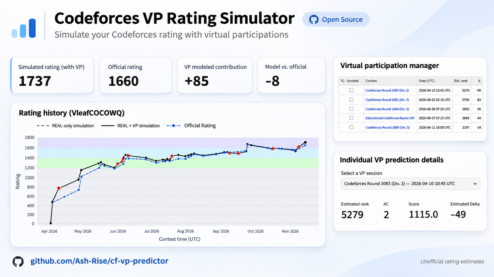

# Codeforces VP Rating Simulator

[简体中文](README.md) · **English**

[Live demo](https://ashrise-cf-vp-predictor.streamlit.app/)



A **Streamlit** tool that reconstructs Codeforces Virtual Participation (VP) results from a user's submission history and estimates a hypothetical Rating trajectory that includes VPs alongside officially rated contests.

> [!IMPORTANT]
> **This is not an official Codeforces Rating calculator.** VP rankings and Rating changes are estimates. Historical contest rules, hacks, Rated eligibility restrictions, and missing API data may affect accuracy.

## Features

- **Chronological contest history:** Combine `user.rating` and `user.status` data and order official rounds and VPs by their **actual start times**, rather than the later Rating update timestamps.
- **Interactive VP manager:** Each VP session has a row showing the contest, date, estimated rank, estimated internal Delta, solved count, and a Codeforces link. Check `Unrated` to recalculate the simulation without downloading data again. Repeated VPs of the same contest are managed separately.
- **Per-contest prediction details:** Inspect estimated ranking, score, accepted problems, ICPC time penalty (when applicable), and up to five real proxy participants used to estimate Rating Delta, including their Handles, profile links, pre-contest Ratings, ranks, actual Deltas, and adjusted Deltas.
- **Two simulated trajectories:** Plot a REAL-only model and a REAL+VP model, optionally alongside the official Rating history. The difference between the two modeled final Ratings is reported as the **VP modeled contribution**. The REAL-only model's deviation from the official Rating is displayed separately.
- **Automatic newcomer handling:** For histories covered by the modern Codeforces newcomer policy, use an internal initial Rating of 1400 and an initial displayed Rating of 0; the first six counted Rated contests apply display bonuses of 500, 350, 250, 150, 100, and 50. No newcomer checkbox is needed. Older histories and the policy transition period remain approximate.
- **Browser-local preferences:** Save the last entered Handle and per-VP Unrated selections in this browser's `localStorage`. Different Handles have separate settings; clearing site data may remove them.

**Unrated selection note:** Mark individual sessions Unrated in the VP manager. It shows a table on wide screens and automatically uses cards on narrow screens. Selections are saved in the current browser. An unexcluded VP is **not** guaranteed to have been eligible for an official Rated result.

## Prediction methodology

1. Read officially rated contest history from `user.rating` and identify virtual submissions via `user.status`.
2. Prefer `author.startTimeSeconds` to distinguish repeated VP sessions, limit submissions to the contest duration, and use `contest.standings` to estimate a historical rank. CF and ICPC scoring are handled separately; unsupported contest types are not silently interpreted as CF.
3. For each potentially rated event, use `contest.ratingChanges` to find real participants with nearby pre-contest Ratings and rankings. The proxy distance is:
   `cost = 0.8 × |R_i − R| + 1.5 × |rank_i − rank|`
   Up to five nearest proxies are selected. When at least three are available, the largest and smallest adjusted Deltas are removed before averaging.
4. Simulate the timeline twice. **VP modeled contribution = final model Rating with VP − final model Rating with REAL contests only.** This is a counterfactual estimate, **not** the points Codeforces would necessarily have awarded.
5. Surface warnings when contest start times, standings, or historical Rating changes are unavailable. Missing data can make a simulation incomplete.

**Empirical leave-one-out check:** Across 10 official contests and 250 sampled rated users, the five-proxy single-contest Delta estimator achieved **MAE 16.57 Rating**, **P90 absolute error 51**, and **mean signed error +0.08**. See the [backtest report (Chinese)](BACKTEST.md) and run `python backtest.py` to reproduce. These are **not** measurements of VP reconstruction or cumulative simulated Rating accuracy. The original heuristic and its parameters remain unchanged.

## Caching and rate limits

- All Codeforces API calls go through a **process-wide request pacer**, with approximately 2.1 seconds or more between request starts and bounded retries.
- Contest listings, standings, and historical `contest.ratingChanges` responses use shared server-side caches to avoid repeated downloads across Handles.
- User submissions are fetched in full initially, then refreshed incrementally with paginated `user.status` requests, including an overlap that refreshes recent verdicts.
- Changing a VP's Unrated status triggers local resimulation; it does not refetch all historical data.
- Fetching provides phased progress and a short preview of identified contests; missing required Rating data halts further estimates and marks the final result incomplete with a retry option.
- The on-disk cache lives in `data/cf_api_v2/`. **Streamlit Community Cloud does not guarantee local disk persistence** across restarts and redeployments.
- Browser-local Handle persistence is separate from server-side API caching.

## Run locally

Python 3.11 or later is recommended.

```bash
git clone https://github.com/Ash-Rise/cf-vp-predictor.git
cd cf-vp-predictor
python -m pip install -r requirements.txt
streamlit run app.py
```

Run the focused offline regression tests and Streamlit startup smoke test:

```bash
python -m unittest discover -v -p "test_*.py"
```

GitHub Actions installs the real app dependencies, checks module imports, and runs the tests. **These checks do not replace end-to-end testing with a real browser and the live Codeforces API.**

## Project structure

| File | Responsibility |
|---|---|
| `app.py` | Streamlit UI, editable VP table, individual prediction details, and charts |
| `cf_api.py` | Codeforces API client, pacing, shared caches, and incremental user status |
| `vp_utils.py` | VP session grouping, score reconstruction, and rank estimation |
| `predictor_core.py` | Five-proxy Delta prediction, counterfactual paths, and proxy evidence |
| `rating_rules.py` | Newcomer displayed Rating rules |
| `persistent_handle.py` | Browser-local Handle persistence |
| `unrated_storage.py` | Browser-local per-VP Unrated preferences |
| `backtest.py` | Repeatable leave-one-out estimator backtest |
| `BACKTEST.md` | Observed ten-contest/250-user backtest results (Chinese) |

## Credits

Forked from [vividStareium/cf-vp-predictor](https://github.com/vividStareium/cf-vp-predictor). The original approach of estimating Rating Delta from nearby historical competitors is preserved, while data handling, interactive controls, and prediction explanations have been expanded.
